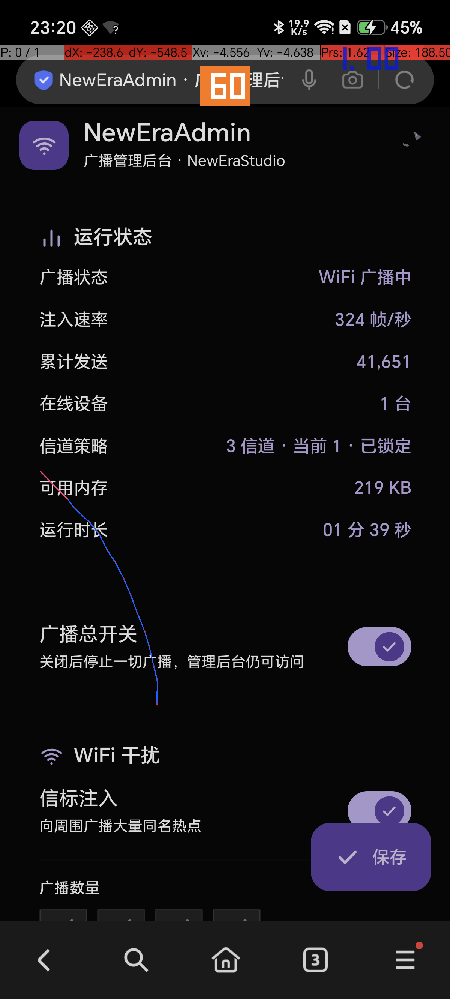
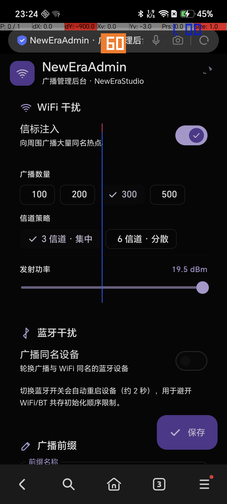
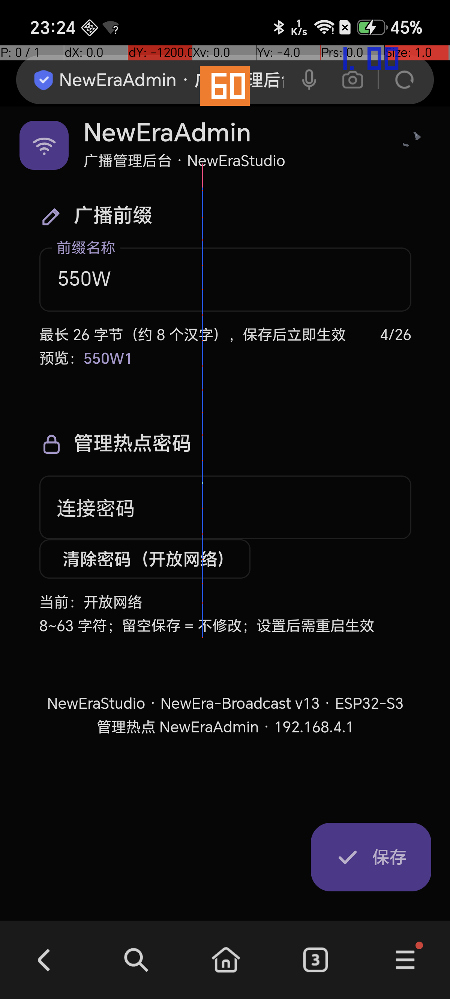

# NewEra-Broadcast

**ESP32-S3 单芯片 WiFi 信标广播器 + NewEraAdmin 管理后台** · by NewEraStudio（新启年工作室）

一块 ESP32-S3，同时干两件事：

1. **广播最多 500 个自定义前缀的 WiFi 热点**（默认 200 个「新启年工作室牛逼1~200」），实测 **~1400 帧/秒** 原始信标注入，每个名字每秒重播 7 次；
2. **自带 `NewEraAdmin` 管理热点**（192.168.4.1），手机/电脑一连上就弹 **MD3 暗色风格 Web 后台**，总开关、干扰参数、前缀、密码全可调，设置存 NVS 掉电不丢。



---

## 功能矩阵

### 广播引擎

| 功能 | 说明 |
|---|---|
| 信标注入 | `esp_wifi_80211_tx()` 原始 802.11 beacon 帧注入，非软 AP 冒充 |
| 数量 | 100 / 200 / 300 / 500 四档，后台可调 |
| 信道策略 | 3 信道 `{1,6,11}` 集中 / 6 信道 `{1,4,6,9,11,13}` 分散 |
| 发射功率 | 8 ~ 19.5 dBm 无级可调 |
| 发送速率 | 强制 2 Mbps 长前导（`WIFI_PHY_RATE_2M_L`），兼容性拉满 |
| 前缀 | ≤26 字节 UTF-8，保存即生效 |
| 蓝牙干扰 | 同批名字轮换广播为 BLE 设备（需重启生效，默认关） |
| 总开关 | 一键停播，管理后台保持在线 |

### NewEraAdmin 管理后台（MD3 暗色，零外部依赖，全离线）

| 功能 | 说明 |
|---|---|
| Captive Portal | `DNSServer` 53 端口通配劫持 + 未知路径 302 回主页，连上即弹后台 |
| 运行状态 | 广播状态 / 注入速率 / **TX 实时曲线** / 累计发送 / 在线设备 / 信道策略 / 内存 / 时长 |
| 开关与参数 | 总开关、WiFi/蓝牙干扰、数量 chips、信道 chips、功率滑条、前缀输入（带字节计数+预览） |
| 管理密码 | 8~63 字符，留空=不修改，可一键清除，重启生效 |
| 重启 / 恢复出厂 | AppBar 两个图标按钮，均带 MD3 确认对话框 |
| 持久化 | `Preferences`（NVS namespace `nebcast`），所有设置掉电保留 |
| 自适应锁台 | 有设备连入时自动锁到 AP 信道单点降载爆发，**被连也不掉线、后台不卡** |




---

## 实测指标（ESP32-S3 DevKitC-1 + Windows PC 强制扫描）

| 指标 | 数值 |
|---|---|
| 注入速率 | **~1400 帧/秒**（无设备连接时，实测峰值 1482） |
| 锁台速率 | ~325 帧/秒（有设备连入，保证 DHCP/HTTP 流畅） |
| PC 单次扫描可见 | 148 / 200 个假热点 + 1 个 NewEraAdmin |
| PC 三轮扫描累计 | 317 个 BSS |
| 每名重播 | 无 STA ~7 次/秒；锁台 ~2.2 次/秒 |
| 稳定性 | 连续 24 万帧注入零崩溃；STA 长连接不掉线 |

---

## 快速开始

### 方式 A：PlatformIO（推荐）

```bash
cd pio
pio run -t upload          # 编译并刷入
pio device monitor         # 看串口日志（115200）
```

> 板子有两条 USB 通路：原生 USB（COM5）和 CH343 UART 桥（COM4）。`platformio.ini` 默认走 CH343（COM4），改插原生口就用 `pio device list` 看实际端口号改 ini。

### 方式 B：Arduino IDE

1. 安装 esp32 开发板支持（≥ 2.x），开发板选 **ESP32S3 Dev Module**；
2. 用仓库根目录的 `NewEra-Broadcast.ino`（与 `pio/src/main.cpp` 同源码，仅去掉 `#include <Arduino.h>`）；
3. 需要库：无第三方依赖，仅 esp32 核心自带（`WiFi`/`WebServer`/`DNSServer`/`Preferences`/`ESP32 BLE`）。

### 连接管理后台

1. 手机/电脑连 WiFi **`NewEraAdmin`**（默认开放无密码）；
2. 浏览器会自动弹出后台；没弹就手动开 **`http://192.168.4.1/`**；
3. 想改密码：后台「管理热点密码」卡片设置 8~63 位，保存后重启生效。

---

## 技术要点

- **原始信标注入**：手工构造 802.11 beacon 帧（MAC 头 + 固定参数 + SSID + 支持速率 + DS 参数），`esp_wifi_80211_tx(WIFI_IF_AP, ...)` 直接打射频；
- **性能关键**：`esp_wifi_set_channel()` 每帧调用会拖死 WiFi 任务（v5 教训：队列只吞 205 帧就 0x101 NO_MEM），只在换台时调；
- **2 Mbps 长前导**：`esp_wifi_config_80211_tx_rate()` 锁 2M_L，TX 从 ~870 拉到 ~1350 帧/秒，老设备也收得到；
- **分组跨信道突发**：PC/手机每信道只驻留 40~100ms，200 个名字单信道发一圈超时会被切成段——按信道分组 + 组内偏移逐轮旋转，保证每信道都被扫到；
- **自适应锁台**：`softAPgetStationNum() > 0` 时锁到 AP 信道 + 每轮 1/4 名字 + **帧间 delay(2) 均匀让位**（集中让位实测 DHCP 拿不到 IP），HTTP/DHCP 响应帧插进队列空隙；
- **BLE 顺序**：蓝牙必须先于 WiFi 初始化，否则 coex abort；开关 BLE 需重启。

## 目录结构

```
NewEra-Broadcast/
├── pio/
│   ├── platformio.ini        # PlatformIO 工程
│   └── src/main.cpp          # 主源码（PlatformIO 版）
├── NewEra-Broadcast.ino      # Arduino IDE 单文件版（与 main.cpp 同源）
├── tools/
│   └── scan_wifi.py          # PC 端 WlanScan 强制全新扫描验证脚本
├── docs/
│   └── screenshot-*.png      # 后台截图
├── LICENSE                   # MIT
└── README.md
```

## 免责声明

本项目仅用于**你自己的设备**上的射频实验、压力测试与 Web 后台技术演示。请遵守当地无线电管理法规，勿用于干扰他人网络或任何未授权场景。作者对滥用不承担任何责任。

---

## English

**NewEra-Broadcast** — an ESP32-S3 firmware that injects up to 500 custom-prefixed WiFi beacons (~1300 frames/s via `esp_wifi_80211_tx`) and hosts a built-in `NewEraAdmin` softAP at `192.168.4.1` with a self-contained Material-3 dark web console (captive portal, live stats, TX graph, NVS persistence). MIT licensed.
